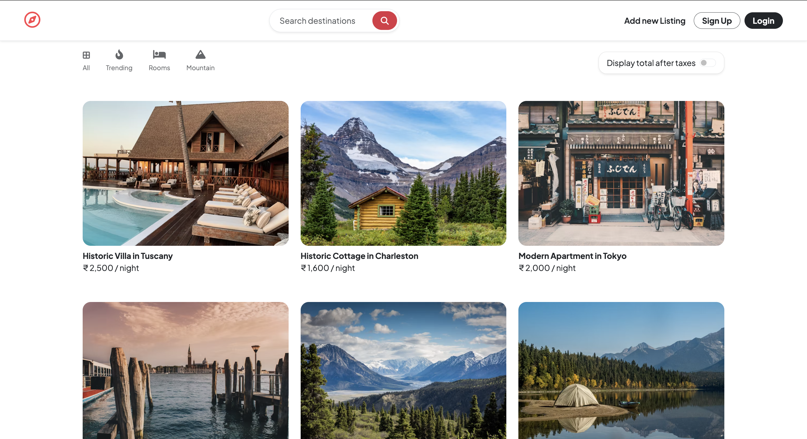
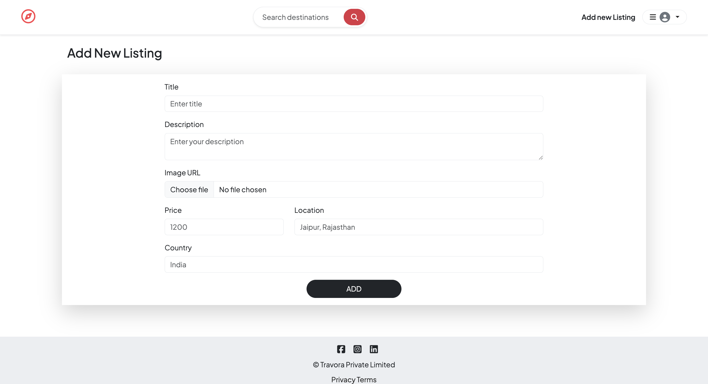
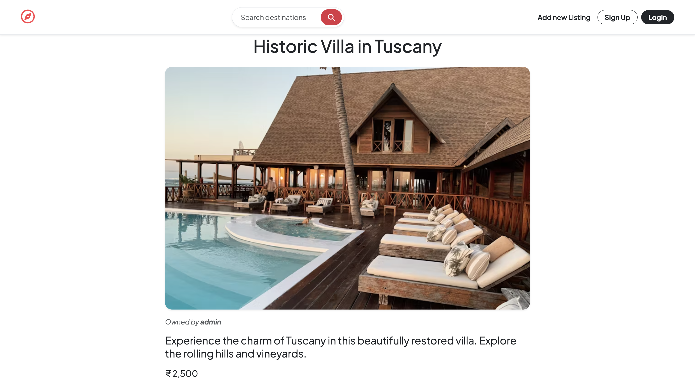
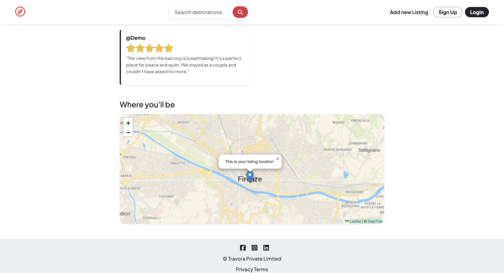
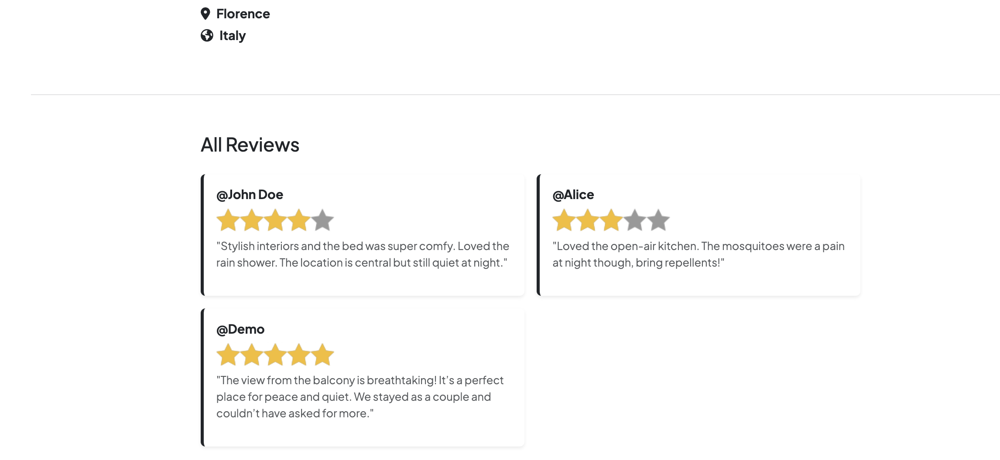
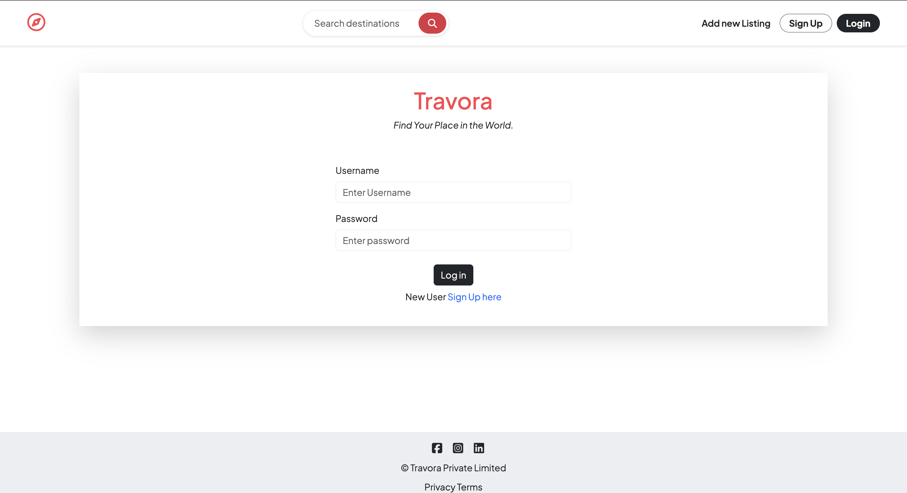
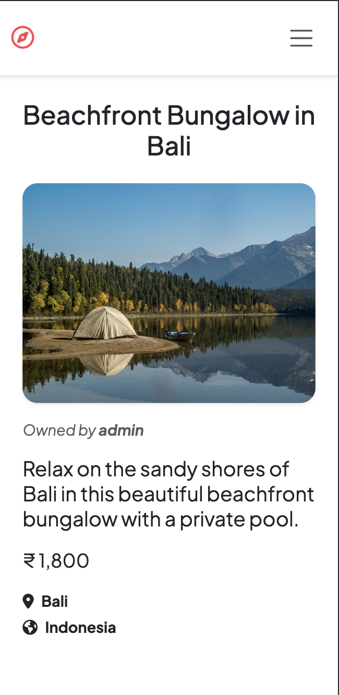

# 🏠 Travora
<p align="center">
  
</p>

<p align="center">
  <strong>A property rental platform built with Node.js, Express.js, MongoDB, and EJS.</strong>
</p>


Travora is a modern property rental and booking platform where users can browse, list, and manage rental properties. It features secure authentication, interactive maps, image uploads, reviews, and a responsive user interface, providing a seamless experience for both property owners and renters.

---

## ✨ Features

- 🔐 Secure user authentication and authorization
- 🏡 Create, edit, and manage property listings (CRUD)
- 🖼️ Upload property images using Cloudinary
- 🗺️ Interactive maps powered by Mapbox
- ⭐ User reviews and ratings
- 📱 Fully responsive user interface
- ⚡ Server-side rendering with EJS
- 🛡️ Input validation and secure route protection
- 🚀 RESTful API architecture following MVC principles

---

## 🛠️ Tech Stack

### Frontend
- HTML5
- CSS3
- JavaScript (ES6)
- Bootstrap
- EJS

### Backend
- Node.js
- Express.js

### Database
- MongoDB
- Mongoose

### Authentication & Security
- Passport.js
- Express Session
- Joi Validation

### Third-Party Services
- Cloudinary
- Mapbox API

### Tools
- Git
- GitHub

---

## 📸 Application Preview

### ➕ Add Property Listing

<p align="center">
  
</p>

---

### 🏡 Property Details

<p align="center">
  
</p>

---

### 🗺️ Interactive Map

<p align="center">
  
</p>

---

### ⭐ Reviews & Ratings

<p align="center">
  
</p>

---

### 🔐 User Authentication

<p align="center">
  
</p>

---

### 📱 Responsive Mobile View

<p align="center">
  
</p>

---

## 📂 Project Structure

```text
Travora/
├── controllers/
├── middleware/
├── models/
├── public/
├── routes/
├── utils/
├── views/
├── app.js
├── cloudConfig.js
├── package.json
└── README.md
```

---

## 🚀 Installation

### Clone the repository

```bash
git clone https://github.com/your-username/travora.git
cd travora
```

### Install dependencies

```bash
npm install
```

### Configure Environment Variables

Create a `.env` file in the root directory.

```env
DB_URL=your_mongodb_connection_string

CLOUDINARY_CLOUD_NAME=your_cloud_name
CLOUDINARY_KEY=your_api_key
CLOUDINARY_SECRET=your_api_secret

MAP_TOKEN=your_mapbox_token

SECRET=your_session_secret
```

### Run the application

```bash
npm start
```

or

```bash
node app.js
```

Visit:

```
http://localhost:3000
```

## ✅ Continuous Integration

GitHub Actions runs on pushes and pull requests to `main`. The workflow uses Node.js 24, restores the npm cache, installs the lockfile with `npm ci`, checks tracked JavaScript syntax, and runs `npm test`. The test suite uses isolated mocks, so CI does not need MongoDB, Cloudinary, Mapbox, or application secrets.

---

## 📸 Key Functionalities

- User Registration & Login
- Property Listing Management
- Image Uploads
- Interactive Property Maps
- Reviews & Ratings
- Authentication & Authorization
- Responsive Design

---

## 🏗️ Architecture

Travora follows the **MVC (Model-View-Controller)** architecture for clean code organization and maintainability.

- **Models** manage database operations.
- **Views** render dynamic pages using EJS.
- **Controllers** contain application logic.
- **Routes** define RESTful endpoints.

---

## 📚 What I Learned

During the development of Travora, I gained practical experience with:

- Full-Stack Web Development
- RESTful API Design
- MongoDB & Mongoose
- Authentication & Authorization
- Cloudinary Image Storage
- Mapbox Integration
- MVC Architecture
- Error Handling & Validation
- Building Scalable Web Applications

---

## 🔮 Future Enhancements

- 📅 Property Booking System
- 💳 Payment Gateway Integration
- ❤️ Wishlist/Favorites
- 🔍 Advanced Search & Filters
- 👤 User Profiles
- 💬 Real-Time Messaging
- 📧 Email Notifications
- 🛠️ Admin Dashboard

---

## 🤝 Contributing

Contributions are welcome! Feel free to fork this repository, create a feature branch, and submit a pull request.

---

## 📄 License

This project is licensed under the **MIT License**.

---

## 👨‍💻 Author

**Devanshu Verma**

- 💼 LinkedIn: https://linkedin.com/in/devanshuvermaa
- 🌐 Portfolio: https://devanshuvermaa.in

---

⭐ **If you found this project helpful, consider giving it a star!**
